# 🤖 Awesome Conversational AI & Open Source Assistants

 

 

**⚡ The Definitive Directory of Self-Hosted ChatGPT Alternatives, Local AI Assistants, Agentic RAG Workspaces & Multi-Model Chat UIs**

*Curated for AI engineers, self-hosters, privacy enthusiasts, indie hackers, and enterprise builders.*

**📅 Last updated: November 2026**

---

## 🧭 Navigation & Table of Contents

- [📊 Sector Overview & Market Dynamics](#-sector-overview--market-dynamics)
- [☁️ SaaS & Hosted AI Platforms](#️-saas--hosted-ai-platforms)
- [🔓 Open-Source GitHub Projects (Ranked by Stars)](#-open-source-github-projects-ranked-by-stars)
- [🛠️ Complementary LLM Engines & Agent Frameworks](#️-complementary-llm-engines--agent-frameworks)
- [🤝 How to Contribute](#-how-to-contribute)
- [💖 Support & Share](#-support--share)
- [⭐ Star History](#-star-history)
- [📜 Disclaimer](#-disclaimer)

---

## 📊 Sector Overview & Market Dynamics

The global conversational AI and intelligent assistant market is projected to reach approximately **$14.3B to $17.3B in 2025** (expanding from ~$11.6B–$15.0B in 2024 at a compound annual growth rate exceeding 23%), catalyzed by enterprise generative AI deployment, agentic workflows, and multimodal interfaces.

The market displays a distinct structural duality:
- **Highly Fragmented Application Layer**: The consumer, indie-hacker, and vertical workplace layer is intensely fragmented. Hundreds of independent desktop clients, Bring-Your-Own-Key (BYOK) interfaces, and niche workflow wrappers compete actively on UX speed, offline privacy, and specialized integrations.
- **Concentrated Foundation & Platform Layer**: Conversely, underlying foundation model intelligence and commercial cloud compute are concentrated in a handful of frontier powerhouses (OpenAI, Anthropic, Google, Microsoft) that attract the majority of direct enterprise AI spend and institutional capital.

---

## ☁️ SaaS & Hosted AI Platforms

*Top proprietary and hosted conversational AI services, sorted by estimated corporate scale (Valuation / Revenue).*

| 🚀 Platform | 📝 Description | 🏢 Company Size (Valuation / Revenue) | 💳 Pricing (Starting Tier) | 🎁 Free Tier Limit |
| :--- | :--- | :--- | :--- | :--- |
| **[ChatGPT](https://chatgpt.com)** (OpenAI) | Flagship cloud conversational AI assistant offering Canvas collaborative editing, Deep Research, multimodal voice/vision, custom GPTs, and memory. | ~$157B–$300B Valuation (2024/2025) / ~$3.7B+ ARR | $20/month (Plus plan) | Free forever; rolling message limits on GPT-4o (~10–16 msgs / 3–5 hrs) before falling back to GPT-4o mini, with limited file uploads, data analysis, and image generation. |
| **[Claude](https://claude.ai)** (Anthropic) | Cloud conversational AI assistant renowned for long-context reasoning, interactive Artifacts UI rendering, Projects knowledge bases, and MCP integrations. | ~$61.5B–$183B Valuation (2025) / ~$1B+ ARR | $20/month (Pro plan) | Free forever; dynamic conversation token budget allowing approx. 15–40 messages per day on Claude Sonnet/Haiku, resetting every 24 hours. |
| **[Perplexity](https://perplexity.ai)** | Cloud AI conversational search and research assistant combining real-time web retrieval with inline source citations and Spaces workspaces. | ~$9B–$20B Valuation (2024/2025) / ~$100M+ ARR | $20/month (Pro plan; $17/mo billed annually) | Free forever; unlimited standard web searches with citations, capped at 3 Pro Searches/day, ~1 Deep Research query/month, and up to 40MB file uploads. |
| **[Poe](https://poe.com)** (Quora) | Multi-model cloud AI chat aggregator enabling users to converse with dozens of frontier and open-weight LLMs, image/video generators, and custom bots in one interface. | ~$500M Valuation (Quora) | $4.99/month (Lite plan; $19.99/mo Standard) | Free forever; allocated a strict rolling budget of 300 compute points every 24 hours (points do not roll over; sufficient for few basic turns, excludes heavy reasoning models). |
| **[Dify Cloud](https://dify.ai)** (LangGenius) | Managed cloud edition of Dify providing hosted visual AI agent workflows, RAG knowledge pipelines, and instant conversational web-app publishing. | $180M Valuation (Series Pre-A, March 2026) / ~$3M+ ARR | $59/month (Professional plan) | Free forever (Sandbox plan); includes 1 team workspace, 1 member, up to 5 apps, 200 message credits for cloud models, 50 knowledge documents (50MB storage), and 5,000 API requests/month. |
| **[LM Studio](https://lmstudio.ai)** (Element Labs) | Polished cross-platform local desktop AI assistant and model runner featuring one-click Hugging Face downloads, local RAG document chat, and an OpenAI-compatible server. | $19.3M Total Funding Raised / ~$1.8M ARR | $0 (Free for personal and internal work use) | Free forever; unrestricted local execution of open-weight models on user hardware with zero software license fees (user supplies compute and local/BYOK models). |
| **[TypingMind](https://typingmind.com)** | Commercial Bring-Your-Own-Key (BYOK) web and desktop AI chat frontend featuring prompt libraries, custom AI agents, knowledge bases, and team admin controls. | ~$1.6M ARR ($130k–$142k/mo) / Bootstrapped | $39 one-time payment (Standard personal license; $79 Extended, $99 Premium) | Free forever (Web version); basic chatting with BYOK key, but does not save chat history, displays regular upgrade prompts every few minutes, and restricts advanced plugins/Artifacts. |
| **[AnythingLLM Cloud](https://anythingllm.com)** (Mintplex Labs) | Hosted cloud edition of AnythingLLM offering zero-maintenance private workspaces, multi-user permissions, and automated document ingestion. | $500k Pre-Seed (YC S22) / ~$1M ARR | $50/month (Basic cloud instance; $99/mo Pro) | No free tier or trial on official Cloud SaaS (requires paid instance; however, self-hosted Docker and local desktop editions are 100% free and open-source). |
| **[Msty](https://msty.app)** | Sleek cross-platform desktop AI assistant supporting offline local models alongside cloud APIs, split-chat comparisons, and local RAG knowledge stacks. | Bootstrapped / Privately Held (<$1M revenue) | $149/year (Aurum commercial license; $349 one-time lifetime) | Free forever; strictly restricted to non-commercial / personal use only, includes core local/BYOK chat, RAG stacks, and split-chat, but excludes commercial rights and cloud integrations (Azure/Bedrock). |

---

## 🔓 Open-Source GitHub Projects (Ranked by Stars)

*Leading open-source conversational AI interfaces, self-hosted ChatGPT alternatives, desktop clients, and autonomous workspace applications, sorted in descending order by GitHub stargazers count.*

1. **[Dify](https://github.com/langgenius/dify)**   
   Leading open-source LLM application development and conversational agent platform combining a visual workflow canvas, RAG pipeline, prompt IDE, and embeddable chat UIs.

2. **[Open WebUI](https://github.com/open-webui/open-webui)**   
   User-friendly, feature-packed self-hosted AI interface supporting Ollama, OpenAI-compatible APIs, local RAG document chat, web search, voice/video interaction, Python execution pipelines, and granular RBAC.

3. **[Browser Use](https://github.com/browser-use/browser-use)**   
   Open-source Python library and autonomous conversational browser agent that makes websites accessible and operable for AI assistants and LLMs.

4. **[LobeChat](https://github.com/lobehub/lobe-chat)**   
   Modern, design-centric open-source AI chat framework featuring Chain-of-Thought visualization, Artifacts, MCP plugin marketplace, text-to-speech, and multi-modal model support.

5. **[AnythingLLM](https://github.com/Mintplex-Labs/anything-llm)**   
   All-in-one open-source desktop and Docker AI assistant turning documents, websites, and codebases into private RAG workspaces with no-code AI agents and multi-user support.

6. **[LocalAI](https://github.com/mudler/LocalAI)**   
   Self-hosted, drop-in OpenAI-compatible alternative engine to run LLMs, vision, voice, audio generation, and image models locally on consumer hardware without GPU mandates.

7. **[Text Generation WebUI](https://github.com/oobabooga/text-generation-webui)**   
   Classic, highly extensible open-source Gradio web interface for running local LLMs with `llama.cpp`, Transformers, ExLlamaV2, LoRA adapters, and fine-grained sampling controls.

8. **[LibreChat](https://github.com/danny-avila/LibreChat)**   
   Enhanced open-source ChatGPT clone unifying OpenAI, Anthropic, Google Gemini, Ollama, OpenRouter, and Azure with Code Interpreter, interactive Artifacts, MCP support, presets, and secure multi-user auth.

9. **[Jan.ai](https://github.com/menloresearch/jan)**   
   Open-source, 100% offline-first desktop AI assistant powered by `llama.cpp` and Cortex, featuring local model downloads, hardware acceleration, and an OpenAI-compatible local server.

10. **[Chatbox](https://github.com/Bin-Huang/chatbox)**   
    Clean, lightweight open-source cross-platform desktop & mobile client (Windows, macOS, Linux, iOS, Android) for local Ollama runtimes and cloud API providers.

11. **[CopilotKit](https://github.com/CopilotKit/CopilotKit)**   
    The open-source React framework and frontend stack for AI agents and Generative UI, enabling developers to embed custom copilots and conversational popups into existing web applications.

12. **[Langchain-Chatchat](https://github.com/chatchat-space/Langchain-Chatchat)**   
    Complete local knowledge-based RAG and conversational AI assistant application powered by LangChain and open-weight models (Llama, Qwen, ChatGLM).

13. **[Khoj](https://github.com/khoj-ai/khoj)**   
    Self-hostable open-source personal AI second brain accessible from web, desktop, Emacs, Obsidian, and WhatsApp with deep research agents and scheduled automations.

14. **[SillyTavern](https://github.com/SillyTavern/SillyTavern)**   
    Power-user LLM frontend engineered for customizable character personas, lorebooks, text-to-speech, speech-to-text, and rich interactive roleplay scenarios.

15. **[Onyx](https://github.com/onyx-dot-app/onyx)**   
    Enterprise-grade open-source AI conversational assistant and workplace search platform connecting to 40+ corporate tools (Slack, Google Drive, Confluence, GitHub) with permission-aware RAG.

16. **[Chatbot UI](https://github.com/mckaywrigley/chatbot-ui)**   
    Clean, minimalist open-source Next.js AI chat interface supporting multiple LLM providers, custom system prompts, file attachments, and self-hosted Supabase backends.

17. **[FastGPT](https://github.com/labring/FastGPT)**   
    Knowledge-based conversational AI platform built on LLMs, offering automated data processing, RAG retrieval, and visual AI workflow orchestration.

18. **[Devika](https://github.com/stitionai/devika)**   
    Agentic open-source software engineering assistant capable of understanding human instructions, decomposing tasks, researching online, and writing code autonomously.

19. **[Chainlit](https://github.com/Chainlit/chainlit)**   
    Open-source Python framework engineered to build scalable conversational AI applications, ChatGPT-like chat UIs, and agent workflows in minutes.

20. **[Big-AGI](https://github.com/enricoros/big-AGI)**   
    Generative AI workspace for experts featuring multi-model "Beam" response comparison, voice interaction, persona workflows, and 800+ model integrations via BYOK.

---

## 🛠️ Complementary LLM Engines & Agent Frameworks

To deploy or build a fully self-hosted conversational assistant stack, combine these top runtime backends and developer frameworks:

- **[Ollama](https://github.com/ollama/ollama)**  — The quintessential local runtime to download and run open-weight models (Llama, Qwen, DeepSeek, Mistral) in macOS, Windows, and Linux.
- **[vLLM](https://github.com/vllm-project/vllm)**  — High-throughput and memory-efficient LLM serving engine with PagedAttention for production self-hosted clusters.
- **[Flowise](https://github.com/FlowiseAI/Flowise)**  — Open-source UI visual tool to build customized LLM orchestration flows and conversational agents.
- **[Gradio](https://github.com/gradio-app/gradio)**  — Rapid Python library for building and sharing interactive machine learning demos and conversational chat interfaces.

---

## 🤝 How to Contribute

We welcome additions and updates from the community! To suggest a new project or update details:

1. 🍴 **Fork this repository**.
2. 🌿 Create a descriptive feature branch (`git checkout -b add-my-assistant`).
3. ✏️ Add or update entries in `README.md` following the established table / star-ranked layout.
4. 🔍 Ensure links are active and descriptions remain concise, objective, and accurate.
5. 🚀 Submit a Pull Request with a short summary of the addition!

---

## 💖 Support & Share

If you find this curated ecosystem directory helpful for discovering or deploying conversational AI assistants, please consider supporting the project:

- ⭐ **Star this repository** to improve visibility and help other developers and researchers find it!
- 🍴 **Fork & Share** it with your colleagues, teammates, and communities on Reddit, LinkedIn, and X/Twitter.
- ☕ **Buy me a coffee / Sponsor**: Support ongoing maintenance and curation of open-source research lists via the [GitHub Sponsor Dashboard](https://github.com/sponsors/ishandutta2007) — thank you for powering independent open-source curation!

---

##  Star History

---

## 📜 Disclaimer

- This is a community-curated directory intended for educational and developmental reference. Inclusion does not constitute an endorsement.
- Closed-source desktop freeware tools (such as LM Studio) are categorized separately under the SaaS & Hosted Platforms section.
- For self-hosted assistants deployed over the public internet, always enforce HTTPS/TLS encryption, user authentication, firewall rules, and secure credential handling.

---

**Made with ❤️ for AI engineers, self-hosters, and open-source creators worldwide.**

